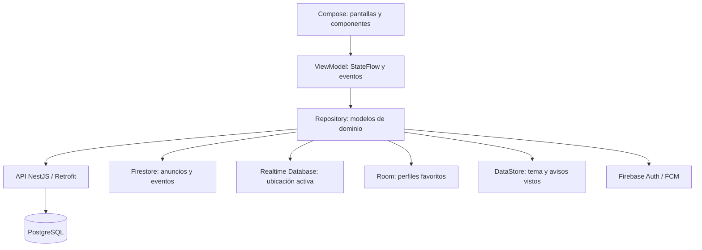
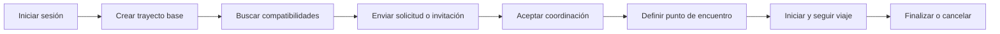

# RutaU Android

## Problema y solución

Carmina, estudiante que depende de contactos cercanos o transporte pagado para llegar al campus, no tiene una alternativa confiable cuando sus horarios no coinciden o le cancelan a última hora. La validación identificó gastos de hasta Q200 en una semana y la barrera de coordinar con estudiantes desconocidos de la misma ruta. RutaU permite registrar trayectos habituales, descubrir compatibilidades y acordar un viaje entre conductor y pasajero. La propuesta de valor es facilitar esa coordinación dentro de la comunidad universitaria, con información de perfil y condiciones visibles antes de aceptar, sin procesar pagos reales.

RutaU se conecta al backend para las reglas del negocio, usa Firebase Authentication para identificar a cada persona y Firebase para avisos y ubicación en vivo. DataStore conserva preferencias y Room guarda perfiles compatibles marcados como favoritos para verlos aun sin conexión.

> La fuente de verdad de perfiles, trayectos, plazas, solicitudes, coordinaciones y notificaciones es PostgreSQL a través de la API. Firestore no duplica esos datos.

## Arquitectura

RutaU se mantiene en un único módulo Android (`app`) organizado por funcionalidad. Cada pantalla usa un `ViewModel`; este llama a una interfaz de repositorio; y el repositorio usa Firebase, la API o DataStore según corresponda. Las pantallas no conocen Retrofit ni las clases de red directamente.



Las pantallas y componentes visuales muestran texto en español. Los identificadores de Kotlin, rutas y modelos se mantienen en inglés para que el código sea consistente. Cada pantalla con lógica recibe un estado inmutable desde un `ViewModel` y emite acciones mediante callbacks; un composable no consulta Firebase, Retrofit, DataStore ni Room directamente.

Las listas principales usan estados visibles para evitar pantallas bloqueadas cuando falla la red:

- `Loading`: la consulta todavía está en progreso.
- `Content`: existen datos para mostrar.
- `Empty`: la consulta terminó sin datos para la sección seleccionada.
- `Error`: se informa el problema y se ofrece un botón **Reintentar**.

## Flujo de usuario

1. La persona inicia sesión con correo/contraseña o Google usando Firebase Authentication.
2. `FirebaseSessionRepository` obtiene el ID token de Firebase y llama a `POST /auth/session` para crear o recuperar el perfil de RutaU.
3. Las pantallas autenticadas leen y escriben información mediante repositorios remotos, que consumen la API NestJS.
4. Cuando hay una coordinación aceptada, conductor y pasajero ven el detalle del viaje. Solo el conductor puede iniciar el viaje y compartir ubicación.
5. Al cerrar sesión se elimina el registro FCM del dispositivo, se detiene el servicio de ubicación y se limpia el historial de navegación.



## Estructura del proyecto

```text
app/src/main/java/uvg/edu/rutau/
├── app/                         Shell y navegación global
├── core/                        Código compartido entre funcionalidades
├── feature/                     Pantallas y ViewModels por funcionalidad
├── ui/theme/                    Tema visual de RutaU
├── MainActivity.kt              Punto de entrada de la interfaz
└── RutaUApplication.kt          Inicializa Firebase y servicios compartidos
```

### `app/`: el contenedor de la aplicación

| Archivo | Responsabilidad |
| --- | --- |
| `RutaUApp.kt` | Une tema, `Scaffold`, navegación, diálogos de avisos y permiso de notificaciones. También consulta avisos internos mientras la app está visible. |
| `RutaUAppState.kt` | Conserva el `NavController`, cambia entre las tres secciones principales y abre el recurso indicado por una notificación. |
| `RutaUNavHost.kt` | Declara todas las rutas tipadas de Navigation Compose. |
| `RutaUScaffold.kt` | Aplica de forma consistente barra superior y barra inferior. |
| `RutaUBottomNavigation.kt` | Navega a **Trayectos**, **Solicitudes** y **Cuenta** conservando el estado de cada sección. |
| `RutaUAppDependencies.kt` | Crea las implementaciones reales de repositorios. Es el punto temporal de composición de dependencias; evita crear clientes de red dentro de pantallas. |

### `feature/`: funcionalidades de interfaz

| Paquete | Contenido |
| --- | --- |
| `feature/auth/` | Inicio de sesión, registro, Google Sign-In, recuperación y restablecimiento de contraseña. `LoginViewModel`, `SignUpViewModel`, `PasswordRecoveryViewModel` y `ResetPasswordViewModel` contienen la lógica de cada recorrido. |
| `feature/account/` | Perfil, cambio de foto, catálogos de universidad/campus, credenciales, preferencias, tema y documentos legales. |
| `feature/account/AccountScreen.kt` | Permite guardar placa y modelo del vehículo; ambos se requieren para conducir. |

| `feature/trips/` | Lista y edición de trayectos base, coincidencias, perfil compatible, explicación de compatibilidad y confirmación de solicitud/invitación. |
| `feature/requests/` | Bandeja de recibidas/enviadas e historial, detalle, decisiones sobre solicitudes y detalle del viaje coordinado. |

Los datos del vehículo se editan en **Cuenta** y se envían a `PATCH /me` del backend. Un pasajero no necesita registrarlos. Al escoger el rol de conductor en un trayecto, la app pide ambos datos y ofrece ir a Cuenta; el servidor vuelve a validar la regla en publicaciones, solicitudes e inicio del viaje. Tras confirmar una coordinación, el pasajero puede ver modelo y placa en el detalle.

Cada funcionalidad usa normalmente cuatro archivos: `*Screens.kt` para la UI, `*ViewModels.kt` para estado y acciones, `*Navigation.kt` para enlazar rutas, y `*Previews.kt` para verificar los composables sin abrir toda la app.

### `core/`: código reutilizable

| Paquete | Para qué sirve |
| --- | --- |
| `core/model/` | Modelos de dominio compartidos: estudiante, trayecto, solicitud, coordinación, roles y estados. No contiene DTO de Retrofit. |
| `core/data/repository/` | Contratos de repositorio e implementaciones reales. `RemoteTripRepository`, `RemoteRideRequestRepository` y `RemoteCoordinationRepository` hablan con la API; `FirebaseSessionRepository` y `FirebaseUserRepository` coordinan Auth y perfil. Las clases `Fake*` y `MockRutaUStore` se conservan solo para pruebas y previews. |
| `core/data/local/` | Base Room, entidad y DAO de perfiles compatibles guardados. Solo se accede a Room desde `RoomFavoriteTripRepository`. |
| `core/data/catalog/` | Lee universidades, campus y zonas de la API y transforma identificadores en nombres visibles. |
| `core/network/` | `BackendApi` define Retrofit; DTOs, mapeadores, envolturas de respuesta, token Firebase e idempotencia viven aquí. |
| `core/auth/` | `GoogleSignInCoordinator` abre Credential Manager y devuelve el ID token de Google que consume Firebase Auth. |
| `core/notifications/` | Registro de dispositivos FCM, recepción de push, canal Android, aviso del sistema, popup dentro de la app y lectura de notificaciones internas del backend. |
| `core/preferences/` | Repositorios DataStore para tema y anuncios Firestore ya vistos. `PopupMessageViewModel` decide qué anuncio mostrar, guarda la interacción y pide la navegación; `PopupMessageHost` solo dibuja el diálogo. |
| `core/location/` | Permisos, servicio foreground y repositorio de Firebase Realtime Database para ubicación durante un viaje activo. |
| `core/firebase/` | Configura Firebase App Check según el tipo de compilación. |
| `core/diagnostics/` | Reporta errores técnicos no fatales a Crashlytics sin enviar datos personales. |
| `core/designsystem/component/` | Botones, campos, listas, barra superior/inferior, mapa y demás composables reutilizables de RutaU. |
| `core/navigation/` | Rutas serializables. Las rutas llevan IDs, no objetos enteros. |

### Tema visual

`ui/theme/` define `Color.kt`, `SemanticColors.kt`, `Type.kt`, `Shapes.kt` y `Dimensions.kt`. `RutaUTheme` aplica el tema claro, oscuro o del sistema. La preferencia se guarda localmente con `ThemePreferenceRepository`.

## Servicios Firebase

El proyecto Firebase configurado es `ruta-u-ebf74`. El archivo `app/google-services.json` debe corresponder a la aplicación Android con `applicationId` `com.apprutau.rutau`.

### Firebase Authentication

La app admite correo y contraseña, además de Google mediante Credential Manager y Firebase Auth. El recorrido está detrás de `SessionRepository` y su implementación real es `FirebaseSessionRepository`:

```text
Correo/Google -> FirebaseAuth -> Firebase ID token
                         |             |
                         +----> POST /auth/session
                                         |
                                  perfil de RutaU listo
```

No se generan JWT propios ni se guarda el ID token en DataStore. `FirebaseAuth` conserva la sesión de forma segura. `FirebaseIdTokenProvider` obtiene el token cuando OkHttp necesita una llamada protegida.

Si la API responde `401`, `FirebaseTokenAuthenticator` solicita una renovación del token una sola vez y repite la llamada. Si el token renovado también es rechazado, se cierra la sesión local para evitar una cuenta inválida.

Después de autenticar con Firebase, siempre se llama a `POST /auth/session`:

- una cuenta existente puede enviar datos vacíos o de perfil ya conocidos;
- una cuenta nueva aporta nombre, correo institucional, universidad y campus;
- el servidor identifica a la persona por el `uid` validado, no por un ID que mande Android.

El registro valida nombre, universidad, campus, correo, contraseña, confirmación y aceptación de términos en cada cambio. **Crear cuenta** solo se habilita cuando todo el formulario es válido; el botón de Google valida únicamente los datos académicos y términos necesarios para ese proveedor.

### Cloud Firestore: anuncios generales dentro de la app

RutaU utiliza NestJS y PostgreSQL como fuente de verdad para perfiles, trayectos, solicitudes, plazas y coordinaciones. Por acuerdo del curso, Firestore se usa para anuncios generales (`appMessages`) y para registrar interacciones reales del usuario (`appMessageEvents`). Ambas operaciones pasan por Repository y se convierten a modelos de dominio antes de llegar a la interfaz.

Firestore no contiene trayectos, solicitudes, plazas ni coordinaciones. La implementación de lectura está en `FirestorePopupMessageFeedRepository` y la de escritura en `FirestorePopupMessageEventRepository`.

Cada documento válido tiene este formato:

| Campo | Tipo | Uso |
| --- | --- | --- |
| `title` | texto | Título del popup. |
| `body` | texto | Mensaje visible. |
| `active` | booleano | Debe ser `true` para mostrarlo. |
| `audience` | texto | `ALL`, `UNIVERSITY:<uuid>` o `CAMPUS:<uuid>`. |
| `priority` | texto | `LOW`, `NORMAL` o `HIGH`. |
| `actionType` | texto | `NONE`, `OPEN_PROFILE`, `OPEN_TRIPS` u `OPEN_REQUESTS`. |
| `actionValue` | texto o `null` | Valor adicional reservado para acciones futuras. |
| `minAppVersionCode` | número | Versión mínima que puede mostrarlo. |
| `startsAt` / `endsAt` | Timestamp o ausente | Ventana opcional de publicación. |
| `createdAt` | Timestamp | Ordena avisos de igual prioridad. |

La app observa cambios en tiempo real, filtra por audiencia, versión y fechas, y muestra un solo anuncio a la vez. Un usuario autenticado solo necesita permiso de lectura para `appMessages`. `PopupMessageViewModel` recibe esta lista desde el repositorio y mantiene la lógica de mostrar, descartar y abrir un anuncio fuera de Compose.

Al mostrar, cerrar o abrir un anuncio, Android crea un evento inmutable en `appMessageEvents`. El evento contiene únicamente el UID de Firebase, ID del anuncio, tipo (`SHOWN`, `DISMISSED` u `OPENED`), versión de la app y timestamp de servidor. Después de escribirlo, el repositorio lee ese mismo documento y lo convierte a `AppPopupMessageEvent` para confirmar la operación sin exponer tipos de Firebase al dominio. Cada cliente solo puede leer por ID sus propios eventos; no puede listar, editar ni borrar eventos. La operación no bloquea la interfaz si no hay red y no contiene correo, ubicación, solicitudes ni trayectos. Las reglas versionadas están en [`firebase/firestore.rules`](firebase/firestore.rules).

### Firebase Cloud Messaging (FCM)

FCM se usa para eventos personales generados por el backend: solicitud recibida, aceptación, rechazo, cancelación, expiración y cancelación de una coordinación.

1. `BackendDeviceRegistrationRepository` obtiene el token de FCM y lo registra mediante `POST /devices` después de crear la sesión del backend.
2. `RutaUFirebaseMessagingService.onNewToken` vuelve a registrarlo al cambiar.
3. `RutaUFirebaseMessagingService.onMessageReceived` procesa `notificationId`, `type`, `resourceId` y `destination`.
4. `RutaUNotificationManager` publica un aviso del sistema en el canal `rutau_updates` cuando Android entrega el mensaje a la app.
5. Al tocarlo, se abre el detalle de solicitud o coordinación y la pantalla vuelve a consultar la API; el push no se toma como información definitiva.

Android 13 o superior exige aceptar el permiso de notificaciones. La app lo solicita después de iniciar sesión. Cuando llega una notificación con la app abierta también se muestra un popup dentro de RutaU. Como respaldo, la app consulta las notificaciones internas del backend cada 30 segundos mientras está en primer plano.

> Los anuncios de Firestore y los push FCM son distintos: Firestore muestra información general dentro de la app; FCM entrega eventos personales desde NestJS al teléfono.

### Realtime Database: ubicación en vivo

Solo se guarda la última ubicación durante un viaje activo, en:

```text
liveTrips/{occurrenceId}/location
```

El conductor inicia la sesión con la API, ejecuta `LiveTripLocationService` como servicio foreground y publica aproximadamente cada 10 segundos. Los pasajeros confirmados solamente escuchan los cambios. Al terminar, cancelar o cerrar sesión se detiene el servicio y se borra el último punto desde Android; el backend también elimina la ocurrencia al cerrar el viaje.

Los campos enviados son `latitude`, `longitude`, `accuracy`, `bearing`, `speed` y `updatedAt` con timestamp de servidor. Las reglas están en [`firebase/database.rules.json`](firebase/database.rules.json): solo miembros confirmados leen y únicamente el UID del conductor escribe.

`RutaULiveMap` muestra el mapa con OpenStreetMap y osmdroid, sin una API key de Google Maps ni facturación de Google Cloud.

### App Check

`FirebaseAppCheckSetup` usa el proveedor Debug para compilaciones `debug` y Play Integrity para `release`. El enforcement debe mantenerse desactivado hasta validar métricas de dispositivos reales. Para APK distribuidas fuera de Google Play no se debe exigir la etiqueta `PLAY_RECOGNIZED`.

### Crashlytics

Crashlytics se inicializa en `RutaUApplication`. `SafeCrashReporter` registra solo una categoría técnica de error; no manda tokens, contraseñas, correos, teléfonos ni coordenadas. La recopilación está activada por build type mediante `CRASHLYTICS_COLLECTION_ENABLED`. Para validar el flujo, `CrashlyticsDebugVerifier` genera una única excepción no fatal anónima por instalación de una compilación `debug`; no se ejecuta en `release`.

La verificación produjo el problema recuperable `RutaUAppDependencies.recordTechnicalError` (`IllegalStateException: Error técnico de RutaU`) y el transporte de Crashlytics recibió HTTP 200. La decisión es conservar el reporte agrupado por categoría técnica, sin información personal, para investigar fallas no relacionadas con conectividad; los errores de red se muestran a la persona en la interfaz, pero no se reportan como fallas de la aplicación.

## Comunicación con el backend

El código del backend NestJS está disponible en [rutaU-back](https://github.com/carlosaltan18/rutaU-back). PostgreSQL permanece como fuente de verdad de los datos de negocio.

### Dirección y configuración de red

`app/build.gradle.kts` genera estas variables `BuildConfig`:

| Variable | Valor actual |
| --- | --- |
| `API_BASE_URL` | `https://rutau-back.onrender.com/api/v1/` |
| `REALTIME_DATABASE_URL` | `https://ruta-u-ebf74-default-rtdb.firebaseio.com/` |
| `CRASHLYTICS_COLLECTION_ENABLED` | `true` |

Actualmente `debug` y `release` usan la API desplegada. Para probar una API local desde el emulador, la URL es `http://10.0.2.2:3000/api/v1/`; en ese caso hay que habilitar tráfico HTTP solo para el build local de desarrollo.

### Retrofit y manejo de errores

`RutaUNetworkClient` crea Retrofit y OkHttp. `BackendApi` declara endpoints, `BackendNetworkModels.kt` contiene DTOs de red y `BackendMappers.kt` los convierte a modelos de `core/model`.

Todas las respuestas exitosas del backend siguen esta forma:

```json
{
  "data": {},
  "meta": { "requestId": "...", "nextCursor": null }
}
```

Los errores usan `error.code`. Las pantallas muestran errores entendibles, pero las decisiones de lógica se toman con el código, no comparando el texto.

Las listas utilizan `meta.nextCursor`; no hay paginación por número. La contribución simulada se transmite en centavos enteros de GTQ, nunca como `Float` o `Double`. Las operaciones de creación que admite el servidor usan `IdempotencyKeyStore` para reutilizar una misma clave al reintentar una operación.

## Datos locales y privacidad

### DataStore

DataStore no reemplaza la base de datos remota. Solo almacena:

| Archivo | Archivo local lógico | Información guardada |
| --- | --- | --- |
| `ThemePreferenceRepository.kt` | `rutau_theme` | `SYSTEM`, `LIGHT` o `DARK`. |
| `PopupMessageRepository.kt` | `rutau_popup_messages` | IDs de anuncios vistos, fecha de visualización y preferencia de popups. |

No se almacenan ID tokens, contraseñas, perfiles, coordenadas ni objetos de negocio sensibles en DataStore.

### Room

Room se usa para la lista local de perfiles compatibles guardados. La persona puede seleccionar **Guardar perfil** desde un perfil compatible y después verlo en la sección **Guardados** de Trayectos. `FavoriteTripEntity`, `FavoriteTripDao` y `RutaULocalDatabase` persisten este dato en `rutau_local.db`; `RoomFavoriteTripRepository` lo transforma a `FavoriteTrip` antes de exponerlo a la interfaz.

Este dato permite demostrar la persistencia local: guarda un perfil, activa modo avión, cierra la aplicación por completo y vuelve a abrirla. El perfil guardado debe continuar en la sección **Guardados**.

### Permisos Android

El `AndroidManifest.xml` declara internet, notificaciones, ubicación aproximada y precisa, y servicio foreground de ubicación. La aplicación solicita cada permiso cuando hace falta: notificaciones al iniciar sesión y ubicación al iniciar un viaje como conductor.

## Cómo ejecutar

### Requisitos

- Android Studio actualizado con JDK integrado (JDK 17 o superior; JDK 21 está probado en el proyecto).
- Android SDK Platform 37.1.
- Un dispositivo o emulador con Android 13 / API 33 o superior.
- Acceso al proyecto Firebase `ruta-u-ebf74` para habilitar proveedores de inicio de sesión y consultar Crashlytics/Firestore si corresponde.

### Configuración relevante

| Propiedad | Valor |
| --- | --- |
| `applicationId` | `com.apprutau.rutau` |
| `namespace` Kotlin | `uvg.edu.rutau` |
| `minSdk` | 33 |
| `targetSdk` | 37 |
| `compileSdk` | 37.1 |
| `versionCode` | 4 |
| `versionName` | `1.3.0` |
| Distribución configurada | APK con Firebase App Distribution |

1. Abra este proyecto en Android Studio y espere la sincronización de Gradle.
2. Confirme que `app/google-services.json` está presente y pertenece al proyecto Firebase correcto.
3. En Firebase Authentication, habilite **Email/Password** y **Google**.
4. Registre los SHA-1/SHA-256 de la firma que use para probar Google Sign-In.
5. Seleccione un dispositivo, acepte permisos al ejecutar y pruebe una cuenta Firebase real.

Compilación desde PowerShell:

```powershell
$env:JAVA_HOME = "C:\Program Files\Java\jdk-21"
.\gradlew.bat :app:assembleDebug
```

La APK queda en `app/build/outputs/apk/debug/`.

Para publicar la versión 4 de prueba en Firebase App Distribution, inicia sesión previamente con `firebase login` y ejecuta desde la raíz del repositorio:

```powershell
$env:JAVA_HOME = "C:\Program Files\Java\jdk-21"
.\gradlew.bat :app:assembleDebug :app:appDistributionUploadDebug
```

La tarea sube la APK `debug` con `versionCode=4` y `versionName=1.3.0`. Las notas de esta versión y el correo de prueba están en [`app/build.gradle.kts`](app/build.gradle.kts); agrega los demás correos a `testers` o configura un grupo antes de publicar para más personas. El plugin usa la sesión del Firebase CLI y `app/google-services.json` para identificar la aplicación. No se guardan credenciales de distribución en este repositorio. El backend debe estar disponible para probar la edición de trayectos y perfiles.

## Pruebas y diagnóstico

Pruebas unitarias y compilación Kotlin:

```powershell
$env:JAVA_HOME = "C:\Program Files\Java\jdk-21"
.\gradlew.bat :app:compileDebugKotlin :app:testDebugUnitTest
```

Pruebas instrumentadas, con dispositivo o emulador conectado:

```powershell
.\gradlew.bat :app:connectedDebugAndroidTest
```

Lint:

```powershell
.\gradlew.bat :app:lintDebug
```

Las pruebas, mocks y previews permiten comprobar UI y mapeos sin depender de Render. Las pruebas manuales contra servicios reales deberían cubrir como mínimo inicio de sesión, renovación del ID token, trayectos, solicitudes, registro FCM, anuncio de Firestore, ubicación con dos cuentas, falta de red y primer inicio lento del servicio gratuito de Render.

Para verificar el comportamiento sin conexión, active el modo avión con la aplicación abierta. Trayectos y Solicitudes deben mostrar un estado de error con **Reintentar**, o datos que ya estén disponibles en memoria, sin cerrar la aplicación ni dejar un indicador de carga permanente.

### Cross-review recibido

El equipo **Los Camotes** (app **UVGspot**) revisó RutaU y registró los siguientes hallazgos en la hoja de trabajo 4. Esta versión atiende los escenarios señalados:

| Escenario | Resultado en RutaU 1.3.0 |
| --- | --- |
| Girar el teléfono mientras se muestra Cuenta | La sincronización de sesión espera a que Navigation Compose restaure la ruta; no envía la cuenta a Trayectos por una ruta todavía inexistente. |
| Girar el teléfono con el formulario de trayecto abierto | El `NavController` conserva la pantalla y `TripEditorViewModel` guarda el borrador en `SavedStateHandle`, incluso si Android recrea el proceso. |
| Dejar vacío el nuevo correo o escribir mal la contraseña actual | El botón de actualización se deshabilita para datos incompletos. Si Firebase rechaza el cambio, el mensaje aparece junto al formulario; si acepta la solicitud, se explica que falta confirmar el enlace enviado al correo nuevo. |

Antes de distribuir, compruebe estos tres recorridos en un dispositivo real: abra Cuenta y gire el teléfono; escriba un trayecto sin guardarlo y gire; intente cambiar el correo con una contraseña incorrecta. No se modificó el backend ni la base de datos para estos ajustes.

## Límites de responsabilidad

- Android presenta y solicita datos; no decide cupos ni estados de negocio.
- NestJS/PostgreSQL valida roles, plazas, solicitudes y coordinaciones.
- Firebase Auth prueba la identidad; Firebase Realtime Database comparte solo ubicación activa; Firestore sirve anuncios generales; FCM entrega eventos personales.
- No añadir servicios Firebase nuevos ni campos de API sin actualizar primero el contrato OpenAPI y las reglas de seguridad correspondientes.

## Mínimos técnicos

| Criterio | Evidencia en el proyecto |
| --- | --- |
| M1 — UI y tema | [RutaUTheme](app/src/main/java/uvg/edu/rutau/ui/theme/Theme.kt) y pantallas organizadas por funcionalidad. |
| M2 — Navegación | [RutaUNavHost](app/src/main/java/uvg/edu/rutau/app/RutaUNavHost.kt) usa rutas tipadas y lleva IDs a los detalles. |
| M3 — Listas eficientes | [TripScreens](app/src/main/java/uvg/edu/rutau/feature/trips/TripScreens.kt) y [RequestScreens](app/src/main/java/uvg/edu/rutau/feature/requests/RequestScreens.kt) usan `LazyColumn` con `key`. |
| M4 — Formulario validado | [SignUpViewModel](app/src/main/java/uvg/edu/rutau/feature/auth/SignUpViewModel.kt) recalcula errores e `isFormValid` en cada cambio; [SignUpScreen](app/src/main/java/uvg/edu/rutau/feature/auth/SignUpScreen.kt) deshabilita el envío inválido. |
| M5 — MVVM | [SignUpViewModel](app/src/main/java/uvg/edu/rutau/feature/auth/SignUpViewModel.kt) expone un `StateFlow` inmutable; las pantallas reciben estado y emiten callbacks. |
| M6 — Repository | [TripRepository](app/src/main/java/uvg/edu/rutau/core/data/repository/TripRepository.kt) define el contrato y [RemoteTripRepository](app/src/main/java/uvg/edu/rutau/core/data/repository/RemoteTripRepository.kt) encapsula el acceso remoto. |
| M7 — Inyección manual | [RutaUAppDependencies](app/src/main/java/uvg/edu/rutau/app/RutaUAppDependencies.kt) compone las implementaciones y las fábricas las reciben por constructor. |
| M8 — Coroutines | Los ViewModels usan `viewModelScope`; el refresco periódico de solicitudes pertenece a [RequestsViewModel](app/src/main/java/uvg/edu/rutau/feature/requests/RequestViewModels.kt), no al repositorio. |
| M9 — Firestore | [PopupMessageRepository](app/src/main/java/uvg/edu/rutau/core/preferences/PopupMessageRepository.kt) lee `appMessages` y crea `appMessageEvents`, mapeando a modelos de dominio; las reglas están en [firestore.rules](firebase/firestore.rules). |
| M10 — Estados visibles | [TripViewModels](app/src/main/java/uvg/edu/rutau/feature/trips/TripViewModels.kt) y [RequestViewModels](app/src/main/java/uvg/edu/rutau/feature/requests/RequestViewModels.kt) representan carga, contenido, vacío y error. |
| M11 — Room | [RutaULocalDatabase](app/src/main/java/uvg/edu/rutau/core/data/local/RutaULocalDatabase.kt), [FavoriteTripDao](app/src/main/java/uvg/edu/rutau/core/data/local/FavoriteTripDao.kt) y [RoomFavoriteTripRepository](app/src/main/java/uvg/edu/rutau/core/data/repository/FavoriteTripRepository.kt). |
| M12 — Convenciones | [Paquetes de UI](app/src/main/java/uvg/edu/rutau/feature) mantienen texto en español y separan el código de negocio; el proyecto ofrece la tarea `lintDebug` en [Gradle](app/build.gradle.kts). |
| M13 — Crashlytics | [SafeCrashReporter](app/src/main/java/uvg/edu/rutau/core/diagnostics/SafeCrashReporter.kt) registra errores no fatales sin datos privados y [RutaUAppDependencies](app/src/main/java/uvg/edu/rutau/app/RutaUAppDependencies.kt) lo invoca ante fallas técnicas de notificaciones que no son de red. [CrashlyticsDebugVerifier](app/src/main/java/uvg/edu/rutau/core/diagnostics/CrashlyticsDebugVerifier.kt) verificó el envío una vez por instalación `debug`, sin ejecutarse en `release`. La consola registra el problema recuperable y el transporte recibió HTTP 200; se conserva para diagnosticar fallas técnicas no relacionadas con red, sin datos personales. |
| M14 — App Distribution | [Configuración Gradle](app/build.gradle.kts) publica APK para pruebas externas mediante Firebase App Distribution. La versión 1.3.0 (4) fue subida con notas y registra una descarga; falta una segunda descarga externa para completar la evidencia requerida. |
| M15 — Estabilidad | [Prueba de navegación](app/src/androidTest/java/uvg/edu/rutau/app/RutaUAppNavigationTest.kt), pruebas unitarias y checklist manual de flujo principal, modo avión y dos cuentas. |

## Alcance

| ID | User story y criterio de aceptación | Decisión | Estado |
| --- | --- | --- |
| F1 | Como estudiante universitario, quiero registrar mi origen, destino y horario habitual para indicar cuándo y por dónde realizo mi trayecto. Criterio: al guardar datos válidos, se muestran nuevamente al consultar el trayecto. | Dentro (Must) | Cumplida en [TripEditorViewModel](app/src/main/java/uvg/edu/rutau/feature/trips/TripViewModels.kt). |
| F2 | Como estudiante universitario, quiero consultar estudiantes con rutas y horarios compatibles para encontrar compañeros fuera de mi círculo cercano. Criterio: con un trayecto registrado, se muestran solo perfiles que cumplen las reglas de compatibilidad definidas. | Dentro (Must) | Cumplida en [MatchesViewModel](app/src/main/java/uvg/edu/rutau/feature/trips/TripViewModels.kt). |
| F3 | Como estudiante universitario, quiero consultar el perfil básico de un estudiante compatible para decidir si coordino un viaje. Criterio: el perfil muestra al menos nombre, rol de transporte y los datos aprobados como visibles. | Dentro (Must) | Cumplida en [TripScreens](app/src/main/java/uvg/edu/rutau/feature/trips/TripScreens.kt). |
| F4 | Como estudiante universitario, quiero enviar, aceptar o rechazar una solicitud para compartir un viaje para confirmar la coordinación. Criterio: al enviarla queda Pendiente y el receptor puede Aceptarla o Rechazarla; ambos ven el estado actualizado. | Dentro (Must) | Cumplida en [RequestViewModels](app/src/main/java/uvg/edu/rutau/feature/requests/RequestViewModels.kt). |
| F5 | Notificar cambios o cancelaciones de una coordinación. | Fuera (Should) | La priorización inicial no la incluyó entre las cuatro historias Must. |
| F6 | Sugerir una cuota de viaje y permitir una oferta manual. | Fuera (Should) | La priorización inicial no la incluyó entre las cuatro historias Must. |
| F7 | Calcular desvíos o rutas alternativas para recoger y dejar pasajeros. | Fuera (Won't) | Requiere rutas dinámicas y APIs de mapas avanzadas, fuera del alcance del curso. |

## Checklist de evidencias para la PR final

- Captura de una versión distribuida por Firebase App Distribution, con notas de versión y al menos dos descargas de personas ajenas al equipo.
- Captura de un error no fatal en Crashlytics y la decisión tomada para atenderlo o justificarlo.
- Los tres hallazgos emitidos al equipo revisado y los tres recibidos, con pasos, esperado, obtenido, severidad y decisión.
- Tabla de observaciones del docente atendidas, cada una enlazada al commit correspondiente.
- Enlaces a las diapositivas en PDF y al video continuo de respaldo del flujo principal.

## Referencias y uso de IA

- [Jetpack Compose](https://developer.android.com/develop/ui/compose)
- [Arquitectura con ViewModel](https://developer.android.com/topic/libraries/architecture/viewmodel)
- [Room](https://developer.android.com/training/data-storage/room)
- [Firebase para Android](https://firebase.google.com/docs/android/setup)
- [Firebase Crashlytics](https://firebase.google.com/docs/crashlytics/get-started?platform=android)
- [Firebase App Distribution](https://firebase.google.com/docs/app-distribution/android/distribute-gradle)
- [Backend RutaU](https://github.com/carlosaltan18/rutaU-back)

### Declaración de uso de IA

El equipo utilizó OpenAI Codex como apoyo para analizar errores, proponer estructura, generar borradores de código y documentación. Cada cambio fue revisado, adaptado al proyecto y comprobado mediante compilación, pruebas, lint o pruebas manuales por integrantes del equipo. El equipo conserva la responsabilidad de comprender y defender las decisiones técnicas presentadas.
